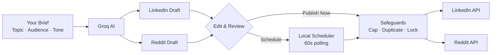

<div align="center">

# 🚀 AutoSocial Poster

### Write once. Publish everywhere. Stay consistent.

**An AI-powered desktop app that drafts, schedules, and publishes your LinkedIn and Reddit posts, with your data and credentials staying on your own PC.**


[Download](#-download--installation) · [Free Trial](#-get-your-activation-key-30-day-free-trial) · [Features](#-features) · [How It Works](#-how-it-works) · [Security](#-security--privacy) · [FAQ](#-faq)

</div>

---

## 📖 Overview

Building a strong digital presence takes consistency, and consistency takes time. **AutoSocial Poster** removes the busywork: tell it your topic and audience, let AI draft platform-native posts for **LinkedIn** and **Reddit**, review and edit them, then publish instantly or schedule them for later.

It runs as a **standalone Windows desktop app**. There is no cloud account to create, no subscription dashboard to log into, and your tokens never leave your machine.

> **Who is it for?** Founders, freelancers, marketers, consultants, indie hackers, and creators who want to show up consistently on LinkedIn and Reddit without spending hours writing and posting.

---

## ✨ Features

### 🧠 AI Content Drafting
- Generates **LinkedIn and Reddit drafts side by side** from a single brief, powered by Groq AI.
- **Platform-native writing:**
  - **LinkedIn:** punchy hook, scannable spacing, a peer-discussion question, and 3–5 niche hashtags.
  - **Reddit:** extracted title, practitioner tone, no marketing buzzwords, and no hashtags.
- **7 tone presets:** Thought Leadership, Conversational, Promotional, Educational, Technical, Storytelling, Controversial / Bold.
- **Reference post mode:** paste a post you admire and the AI matches its style and rhythm.
- **Smart CTA handling:** links are included only when you provide a URL.
- Every draft is **fully editable** with live character counters before anything goes out.

### 📅 Scheduling and Queue Management
- Interactive **calendar picker** with per-day post indicators.
- Schedule to **LinkedIn, Reddit, or both** in one step.
- Quick time presets (`09:00`, `10:00`, `14:00`, `17:00`) and subreddit quick-select tags.
- **Edit, reschedule, cancel, or delete** any queued post.
- **Startup catch-up:** if the app was closed when a post came due, it publishes automatically when it is less than 2 hours overdue. Anything older is marked **Missed** so you can review it first.

### 📊 Dashboard and History
- At-a-glance cards: **Scheduled · Published · Missed/Failed · Connected Platforms**.
- Alert banner when posts were missed while your PC was off.
- Full **Posts & History** view with status filters (`All`, `Scheduled`, `Published`, `Missed`, `Failed`, `Draft`) and live search.
- Built-in **API Log drawer** showing the last 50 requests with expandable request and response payloads.

### 🔌 Flexible Integrations
- **Central Shared App (default):** connect with one click, no developer setup.
- **Custom Developer App:** bring your own LinkedIn or Reddit credentials, with helper buttons for redirect URIs.
- Revert to the shared app any time with one click.

### 🛡️ Built-In Account Safeguards
| Safeguard | What it does |
| :--- | :--- |
| **Daily post cap** | Defaults to 5 posts per day per platform to avoid spam flags. |
| **7-day duplicate guard** | Blocks identical content to the same platform within 7 days. |
| **Idempotency lock** | Atomic status transition prevents double-posting on slow networks. |
| **Rate-limit handling** | Exponential backoff and retry on HTTP `429`. |
| **LinkedIn character escaping** | Reserved characters are escaped so your text is not truncated. |

---

## 🎁 Get Your Activation Key (30-Day Free Trial)

AutoSocial Poster needs an activation key to install. **You can try everything free for 30 days.**

**How to get a key:**

1. **Contact me directly** and I will send you a trial key:
   - 📧 Email: `your-email@example.com`
   - 💼 LinkedIn: `https://linkedin.com/in/your-profile`
   - 💬 Other: `your-contact-link`
2. **Or wait for the public key**, which will be published in this README soon. Star ⭐ or watch the repo to get notified.

Once you have your key, enter it in the installer wizard. It is saved automatically, so there is nothing to set up later.

> 🔔 **Coming soon:** the public 30-day trial key will be posted here.

---

## 📥 Download & Installation

### System Requirements
| Requirement | Details |
| :--- | :--- |
| **OS** | Windows 10 / 11 (x64) |
| **Admin rights** | Not required (per-user install) |
| **Runtime** | Microsoft Edge WebView2 (preinstalled on Windows 11; the app falls back to your default browser if missing) |
| **Internet** | Needed for AI generation and publishing |

### Install in 4 Steps
1. **Download** the latest installer: `AutoSocialPoster_Setup_v1.0.0.exe` from the [Releases](../../releases) page.
2. **Run** the installer and enter your **activation key** when prompted.
3. **Choose** whether to add a desktop shortcut, then finish the wizard.
4. **Launch** AutoSocial Poster and follow the Quick Start below.

> 💾 **Your data is safe.** Databases, logs, and settings live in `%APPDATA%\AutoSocialPoster` and are **never deleted** by updates or uninstalls.

---

## 🚦 Quick Start

1. **Add your Groq API key**: *Settings → Groq AI Configuration → Save Groq Key*.
2. **Connect your accounts**: *Dashboard* or *Settings* → **Connect LinkedIn** / **Connect Reddit**.
3. **Draft a post**: open **Create**, fill in topic, message, audience, and tone, then click **✨ Generate Content with AI**.
4. **Review and edit** both drafts.
5. **Publish Now**, **Save Draft**, or **Schedule** (choose LinkedIn, Reddit, or both).
6. Track everything in **Posts & History** and the **Calendar**.

> ⚠️ **Keep the app running** at your scheduled time. Posts are dispatched by the local scheduler, which checks every 60 seconds.

---

## 🧭 How It Works



**Under the hood:**

| Layer | Technology |
| :--- | :--- |
| Desktop shell | PyWebView (Edge WebView2) with browser fallback |
| Backend | FastAPI (Python) |
| Frontend | React 19 · Tailwind CSS · Lucide icons |
| Database | SQLite (WAL mode, auto-migrating schema) |
| Secrets | Windows DPAPI via `keyring` |
| AI | Groq (`openai/gpt-oss-120b`) |
| Auth | OAuth 2.0 with PKCE |
| Packaging | PyInstaller → `poster-v2.exe`, Inno Setup installer |

---

## 🔒 Security & Privacy

Security is designed in from the start.

- **Local-first:** no AutoSocial cloud. Your posts and history stay on your PC.
- **Encrypted vault:** OAuth tokens, client secrets, and API keys are stored in the **Windows DPAPI vault**, never in plaintext and never in SQLite.
- **Masked secrets:** the UI never receives your stored secrets back; it shows `••••••••` indicators only.
- **Session-token handshake:** a fresh random 32-byte token is generated on every launch and required (`X-Session-Token`) for all `/api/*` calls, validated with constant-time comparison.
- **Self-healing sessions:** after a restart, the UI re-syncs automatically and retries failed requests.
- **OAuth 2.0 + PKCE:** secure code challenge, with 10-minute expiring state values to prevent CSRF replay.
- **Input sanitization:** `<script>`, `<iframe>`, and control characters are stripped before AI processing.
- **Profile isolation:** each Windows user account has its own separate data.
- **Single-instance lock:** prevents port conflicts and database corruption.

---

## 🖥️ Screens at a Glance

| Screen | What you do there |
| :--- | :--- |
| **Dashboard** | See stats, account status, upcoming queue, and missed-post alerts. |
| **Create** | Brief the AI, edit dual drafts, publish or schedule. |
| **Posts & History** | Filter, search, edit, publish, cancel, or delete posts. |
| **Calendar** | Visualize your schedule and manage posts by day. |
| **Settings** | Activate your license, add API keys, configure OAuth apps. |

<!-- Add screenshots here:


-->

---

## 📈 Make It Work for Your Digital Presence

- **Stay consistent:** batch a week of posts in one sitting and let the scheduler handle the rest.
- **Sound like you:** use *Reference Post* mode and tone presets to keep your voice authentic.
- **Show up where your audience is:** LinkedIn for professional reach, Reddit for community credibility.
- **Build authority:** share insights, stories, and lessons regularly, and let compounding visibility do the work.
- **Save hours every week:** go from idea to published post in minutes.

---

## 🔌 REST API (Local)

The app exposes a local API on `127.0.0.1:8000`, used by the built-in UI. Most endpoints require the session token.

<details>
<summary><b>View endpoint directory</b></summary>

| Method | Endpoint | Auth | Purpose |
| :--- | :--- | :---: | :--- |
| `GET` | `/api/health` | No | Health, database status, uptime |
| `GET` | `/api/bootstrap` | No | Session token and config bootstrap |
| `GET` | `/auth/{platform}` | Yes | Start OAuth (PKCE) |
| `POST` | `/api/auth/{platform}/open-browser` | Yes | Open OAuth login in default browser |
| `GET` | `/auth/{platform}/callback` | No | OAuth callback and token storage |
| `GET` | `/api/accounts` | Yes | Connection states and token expiry |
| `POST` | `/api/accounts/{platform}/disconnect` | Yes | Remove tokens from vault |
| `GET` | `/api/posts` | Yes | List posts |
| `POST` | `/api/posts` | Yes | Create or schedule a post |
| `PATCH` | `/api/posts/{post_id}` | Yes | Edit content, destination, or schedule |
| `POST` | `/api/posts/{post_id}/publish` | Yes | Publish immediately |
| `POST` | `/api/posts/{post_id}/cancel` | Yes | Cancel schedule, revert to draft |
| `DELETE` | `/api/posts/{post_id}` | Yes | Delete post |
| `POST` | `/api/content/generate` | Yes | Generate dual-platform drafts |
| `GET` / `POST` | `/api/settings/integrations` | Yes | Read (masked) / save integration settings |
| `POST` | `/api/settings/integrations/{platform}/reset-to-shared` | Yes | Revert to shared app |
| `GET` | `/api/license/status` | Yes | License status |
| `POST` | `/api/license/activate` | Yes | Activate license |

</details>

---

## 🛠️ Development

<details>
<summary><b>Build from source</b></summary>

> Commands below are a typical workflow, so adjust them to match your repository layout.

```bash
# 1. Clone
git clone https://github.com/<your-username>/<your-repo>.git
cd <your-repo>

# 2. Backend dependencies
pip install -r requirements.txt

# 3. Frontend build
cd frontend && npm install && npm run build && cd ..

# 4. Run
python launcher.py

# 5. Headless verification (health, bootstrap, token injection)
python launcher.py --check
```

**Packaging:** compile with PyInstaller to `poster-v2.exe`, then build the installer with Inno Setup using `installer.iss`.

</details>

---

## ❓ FAQ

<details>
<summary><b>Does the app need to be open for scheduled posts to go out?</b></summary>
Yes. Scheduling is handled by a local background scheduler. If the app was closed at the scheduled time, it catches up on launch (under 2 hours overdue) or marks the post <b>Missed</b> for your review.
</details>

<details>
<summary><b>Why can I only schedule 7 days ahead?</b></summary>
This keeps queues fresh and reduces the risk of stale or mistimed content. The limit is enforced in both the UI and the backend.
</details>

<details>
<summary><b>Is there a mobile app or email feature?</b></summary>
No. AutoSocial Poster is a Windows desktop application focused on LinkedIn and Reddit publishing.
</details>

<details>
<summary><b>Where is my data stored?</b></summary>
Locally in <code>%APPDATA%\AutoSocialPoster</code>. Secrets are kept in the Windows DPAPI vault.
</details>

<details>
<summary><b>Do I need my own LinkedIn or Reddit developer app?</b></summary>
No. The Central Shared App works out of the box. Advanced users can switch to custom credentials in Settings.
</details>

<details>
<summary><b>How do I get an activation key?</b></summary>
See <a href="#-get-your-activation-key-30-day-free-trial">Get Your Activation Key</a>. Contact me for a 30-day free trial key.
</details>

---

## ⚖️ Responsible Use

AutoSocial Poster is built to help you publish **genuine, valuable content** consistently. Please:

- Follow the **Terms of Service and API policies** of LinkedIn and Reddit.
- Respect **subreddit rules**, since many communities restrict self-promotion.
- Review every AI-generated draft before publishing. You are responsible for what you post.

The built-in daily cap and duplicate guard exist to protect your accounts, so please do not try to work around them.

---

## 🗺️ Roadmap

- [ ] Publicly available trial key for 30 free trail
- [ ] Additional platforms
- [ ] Analytics and performance insights
- [ ] Post templates and content library

*Have an idea? [Open an issue](https://github.com/sairam-s0/social-media-posting-automation/issues) or contact me directly.*

---

## 🤝 Support & Contact

- 📧 **Email:** `sairam.1242006@gmail.com`
- 💼 **LinkedIn:** `https://linkedin.com/in/sairam-s0`
- 🐛 **Bugs and feature requests:** [GitHub Issues](https://github.com/sairam-s0/social-media-posting-automation/issues)

---


---

<div align="center">

**If AutoSocial Poster helps you grow your presence, give it a ⭐**

Made with ❤️ for creators and builders.

</div>
